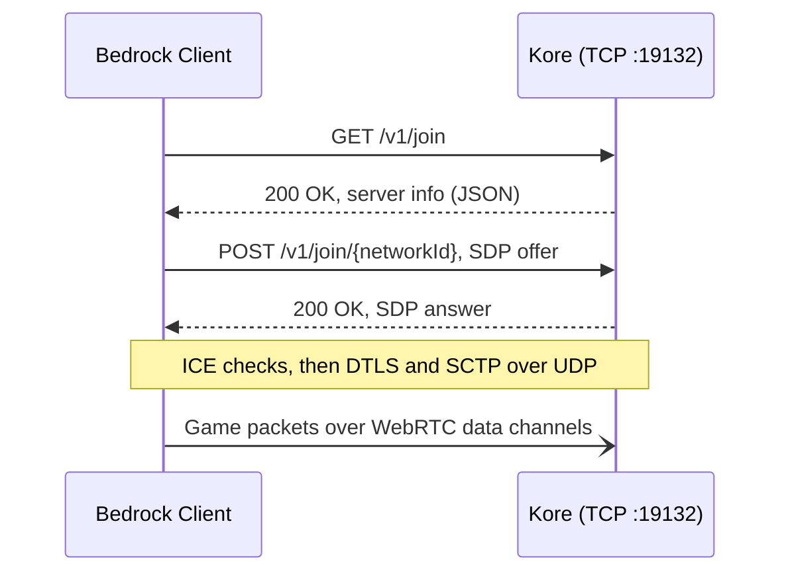

<div align="center">

# ⛏️ Kore

**A lean, modern Minecraft: Bedrock Edition server engine, written from scratch in Kotlin.**

[](https://kotlinlang.org)
[](https://adoptium.net)
[](https://netty.io)
[](https://minecraft.wiki/w/NetherNet)
[](#-milestones)
[](LICENSE)

[Philosophy](#-philosophy) · [Tech Stack](#-tech-stack) · [How It Connects](#-how-a-client-connects) · [Getting Started](#-getting-started) · [Milestones](#-milestones) · [Contributing](CONTRIBUTING.md)

</div>

---

> [!WARNING]
> Kore is in early development. The server answers the NetherNet discovery request, but players can't join yet.
> Follow the [milestones](#-milestones) to see where things stand.

## 🧭 Philosophy

Kore is not a fork, a wrapper, or a port of an existing server. It's a ground-up engine built around a few rules:

- **Simple beats clever.** Small files, flat packages, plain functions. If a newcomer can't follow a code path in one sitting, it's too complicated.
- **Fast by default.** Non-blocking I/O end to end, no reflection-driven plugin layer, no work on the event loop that doesn't belong there.
- **Real Kotlin.** Data classes, sealed types, extension functions and lambdas. Not Java written with Kotlin syntax.
- **No legacy baggage.** No `Manager` singletons, no abstract base class towers, no Bukkit-era patterns kept around for familiarity.
- **NetherNet only.** RakNet is deprecated for Bedrock Dedicated Server. Kore targets the WebRTC-based NetherNet transport and nothing else.

## 🧰 Tech Stack

| Layer | Choice | Why |
| --- | --- | --- |
| Language | **Kotlin 2.4** on **JDK 25** | Concise, null-safe, and a first-class JVM citizen. |
| Build | **Gradle** (Kotlin DSL) | One language for the code and the build. |
| Networking | **Netty 4** | Battle-tested non-blocking I/O for both the TCP signaling and the UDP game traffic. |
| Serialization | **kotlinx.serialization** | Compile-time JSON codecs with no reflection. |
| Logging | **SLF4J + Logback** | Structured, configurable, and fast enough to stay out of the way. |

## 🔌 How a Client Connects

NetherNet splits a connection into two phases: an HTTP signaling handshake over TCP, followed by a WebRTC peer connection that carries gameplay over UDP.



| Step | What happens | Kore status |
| --- | --- | --- |
| Discovery | `GET /v1/join` returns name, version, level and player counts as JSON | ✅ Implemented |
| Offer / answer | `POST /v1/join/{networkId}` exchanges SDP with all ICE candidates included | 🚧 Logged, returns `501` |
| Peer connection | ICE, DTLS and SCTP bring up the `ReliableDataChannel` and `UnreliableDataChannel` | ⏳ Planned |

## 🚀 Getting Started

**Requirements:** JDK 25. Gradle downloads a matching toolchain if you don't have one.

```bash
git clone https://github.com/KoreMC/kore.git
cd kore
./gradlew run
```

Kore binds the signaling server to TCP port `19132`. Check that it's reachable:

```bash
curl -i http://localhost:19132/v1/join
```

```json
{"name":"Kore Server","protocol":2193,"version":"26.50","level":"world","players":0,"maxPlayers":20,"gameType":0}
```

Every request is logged to the console. Set the `org.koremc` logger to `DEBUG` in `src/main/resources/logback.xml` (the default) to also see headers and SDP offers.

> [!NOTE]
> Server settings live in [`ServerConfig.kt`](src/main/kotlin/ServerConfig.kt) until there's a config file. The defaults target 26.50 (protocol `2193`). Update `protocol` and `version` together when moving to a new client release.

## 🗂️ Project Layout

```text
src/main/kotlin/
├── Main.kt                          # Entry point: wires config, server and shutdown
├── ServerConfig.kt                  # Server settings
└── network/
    ├── SignalingServer.kt           # Netty bootstrap and HTTP pipeline
    ├── NetherNetSignalingHandler.kt # Routes /v1/join requests
    └── JoinInfo.kt                  # Discovery response body
```

Packages follow the Kotlin convention of omitting the common root, so `org.koremc.network` lives in `src/main/kotlin/network/`.

## 🗺️ Milestones

### Phase 1: Transport
- [x] Netty bootstrap with an HTTP/1.1 pipeline
- [x] **NetherNet HTTP Signaling:** discovery (`GET /v1/join`)
- [ ] **NetherNet HTTP Signaling:** SDP offer/answer (`POST /v1/join/{networkId}`)
- [ ] **UDP Channel Negotiation:** ICE, DTLS and SCTP
- [ ] Message framing over reliable and unreliable data channels

### Phase 2: Protocol
- [ ] Packet codec and registry
- [ ] Login, Xbox Live authentication and encryption
- [ ] **Cloudburst NBT Parsing**
- [ ] Resource pack and start game sequence

### Phase 3: World
- [ ] **World Loading** (LevelDB)
- [ ] Chunk serialization and streaming
- [ ] Player spawning and movement

### Phase 4: Gameplay
- [ ] Block breaking and placing
- [ ] Inventories
- [ ] Entities
- [ ] Commands

## 🤝 Contributing

Contributions are welcome. Read [CONTRIBUTING.md](CONTRIBUTING.md) before opening a pull request. It covers the code standards and the review process.

## 📚 References

- [NetherNet](https://minecraft.wiki/w/NetherNet) and [Bedrock Edition protocol](https://minecraft.wiki/w/Bedrock_Edition_protocol) on the Minecraft Wiki
- [CloudburstMC](https://github.com/CloudburstMC) for NBT and protocol libraries

## 📄 License

Kore is released under the [MIT License](LICENSE).

<sub>Kore is not an official Minecraft product and is not approved by or associated with Mojang Studios or Microsoft.</sub>
