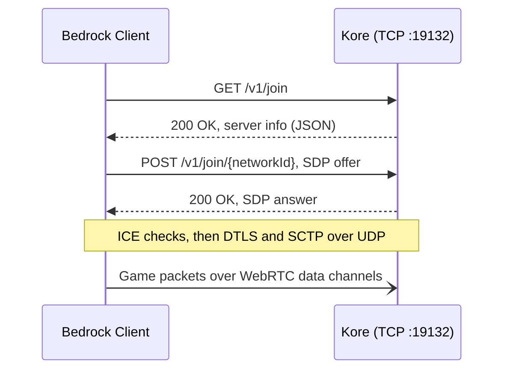

<div align="center">

# ⛏️ Kore

**A lean, modern Minecraft: Bedrock Edition server engine, written from scratch in Kotlin.**

[](https://kotlinlang.org)
[](https://adoptium.net)
[](https://netty.io)
[](https://minecraft.wiki/w/NetherNet)
[](#-milestones)
[](LICENSE)

[Philosophy](#-philosophy) · [Tech Stack](#-tech-stack) · [How It Connects](#-how-a-client-connects) · [Getting Started](#-getting-started) · [Milestones](#-milestones) · [Contributing](CONTRIBUTING.md)

</div>

---

> [!WARNING]
> Kore is in early development. Players can join a flat world, walk around it, mine it, build in it and open its doors, see each other doing it, and chat.
> Follow the [milestones](#-milestones) to see where things stand.

## 🧭 Philosophy

Kore is not a fork, a wrapper, or a port of an existing server. It's a ground-up engine built around a few rules:

- **Simple beats clever.** Small files, flat packages, plain functions. If a newcomer can't follow a code path in one sitting, it's too complicated.
- **Fast by default.** Non-blocking I/O end to end, no reflection-driven plugin layer, no work on the event loop that doesn't belong there.
- **Real Kotlin.** Data classes, sealed types, extension functions and lambdas. Not Java written with Kotlin syntax.
- **No legacy baggage.** No `Manager` singletons, no abstract base class towers, no Bukkit-era patterns kept around for familiarity.
- **NetherNet only.** RakNet is deprecated for Bedrock Dedicated Server. Kore targets the WebRTC-based NetherNet transport and nothing else.

## 🧰 Tech Stack

| Layer | Choice | Why |
| --- | --- | --- |
| Language | **Kotlin 2.4** on **JDK 25** | Concise, null-safe, and a first-class JVM citizen. |
| Build | **Gradle** (Kotlin DSL) | One language for the code and the build. |
| Networking | **Netty 4** | Battle-tested non-blocking I/O for both the TCP signaling and the UDP game traffic. |
| Serialization | **kotlinx.serialization** | Compile-time JSON codecs with no reflection. |
| NBT | **Cloudburst NBT** | Reads the vanilla data, and writes NBT for packets and block state hashes. No dependencies of its own. |
| Game data | **[KoreMC/data](https://github.com/KoreMC/data)** | Items, block states, biomes and the creative inventory, dumped from the game by CloudburstMC. Kept in its own repository and read from `data/` on start. |
| Security | **JDK** (DTLS 1.2, ECDSA) | The JDK's non-blocking DTLS engine fits Netty, and needs no native libraries or BouncyCastle. |
| Logging | **SLF4J + Logback** | Structured, configurable, and fast enough to stay out of the way. |

## 🔌 How a Client Connects

NetherNet splits a connection into two phases: an HTTP signaling handshake over TCP, followed by a WebRTC peer connection that carries gameplay over UDP.



| Step | What happens | Kore status |
| --- | --- | --- |
| Discovery | `GET /v1/join` returns name, version, level and player counts as JSON | ✅ Implemented |
| Offer / answer | `POST /v1/join/{networkId}` exchanges SDP with all ICE candidates included. The answer is signed with the operator identity. | ✅ Implemented |
| Connectivity | ICE checks find a UDP path, then DTLS secures it | ✅ Implemented |
| Data channels | SCTP inside DTLS carries the `ReliableDataChannel` and `UnreliableDataChannel` | ✅ Implemented |
| Framing | A one-byte header splits large messages across the reliable channel and joins them back up | ✅ Implemented |

Kore keeps its side of WebRTC as small as possible. It runs **ICE-lite** and takes the **passive DTLS** role, so it never initiates anything. Every client shares one UDP port: Kore answers their connectivity checks, then waits for each client's first DTLS message. A client's DTLS certificate is accepted only if it matches the fingerprint in that client's offer.

**SCTP is written in Kotlin**, with no native libraries. It covers only what data channels need: one path, no multihoming, and partial reliability so the unreliable channel can drop messages instead of retransmitting them.

Game code sees none of this. Each client is a `NetherNetConnection` that sends and receives whole messages, reliably or not, through three callbacks:

| Callback | When it runs |
| --- | --- |
| `onConnect` | Once, as soon as the client's reliable channel opens and it can be sent to |
| `onMessage` | For every complete message |
| `onDisconnect` | Once, with a reason, for every client `onConnect` announced: it closed, timed out, broke the protocol, or the server stopped |

All three run on the UDP event loop, so they must never block. If one throws, the error is logged and the connection carries on.

## 🚀 Getting Started

**Requirements:** JDK 25. Gradle downloads a matching toolchain if you don't have one.

```bash
git clone https://github.com/KoreMC/kore.git
cd kore
git clone https://github.com/KoreMC/data.git data
./gradlew run
```

The second clone fetches the [game data](#-vanilla-data) Kore reads on start. Kore won't start without it.

Kore uses port `19132` for both signaling (TCP) and gameplay (UDP), so open both in your firewall. Check that signaling is reachable:

```bash
curl -i http://localhost:19132/v1/join
```

```json
{"name":"Kore Server","protocol":2193,"version":"1.26.50","level":"world","players":0,"maxPlayers":20,"gameType":0}
```

The console shows what's happening at `INFO`. Each run also writes everything, at `DEBUG`, to its own file in `logs/`, named for when the server started (for example, `logs/kore-2026-10-11_14-10-57.log`). The file has:
- requests and their headers, and SDP offers;
- each step of every connection;
- every packet batch in and out, listed by packet.

Once a player is in the game, batches holding nothing but movement are left out, since one arrives every tick. Movement carrying an action, like breaking a block, stays in. Set the `org.koremc.packets` logger to `TRACE` in [`logback.xml`](src/main/resources/logback.xml) to include them.

Player identity tokens are redacted, and logins are logged only by size. Kore never deletes old logs, so clear out `logs/` now and then.

### 🔑 The Operator Key

On first run, Kore creates `operator.key` in its working directory. Every SDP answer is signed with this key. Players connecting over plain HTTP are asked to trust it once, and then the client remembers it.

- **Keep it safe.** Anyone holding it can sign answers as your server.
- **Don't regenerate it.** A new key prompts every returning player again.
- **Share it across servers** if you run several. Players then trust them all with one prompt.

### 🛡️ Authentication

Kore runs in **online mode** by default: every player must prove who they are through Xbox Live. Each check closes off a different way of lying:

1. **The offer** carries the client's key and its signature over the connection's DTLS fingerprints. That ties the connection to a key the client holds.
2. **The login token** must be signed by Minecraft's authorization service, for the multiplayer audience, and must not have expired.
3. **The login's key** must be the one the offer proved. A login captured from one connection can't be replayed on another.
4. **The client data** (skin, device and so on) must be signed by that key.

Kore finds the authorization service through Minecraft's service discovery and keeps its signing keys cached, refreshing them in the background. So the server needs outbound HTTPS. A login that fails any check gets a `Disconnect`, and the reason goes to the log.

`onlineMode = false` turns all of this off for local testing. Anyone can then join under any name, so never run it where the public can reach it.

### ⌨️ Commands and Operators

Players run commands from the chat, and you can type them into the console Kore runs in, without the slash. Kore writes each command the game's way, so the client completes it as it's typed, with the item names `/give` takes. It also lists each command in its own `/help`, and shows what came of it in the player's own language. Target selectors work as in the game: `@s`, `@p`, `@a`, `@r`, `@e` and `@n`, with `r`, `rm`, `c`, `m`, `name` and the rest. Coordinates can be offsets from the player (`~`) or along the way they face (`^`).

Every player may run `/list`, `/me` and `/tell` (or `/w` and `/msg`), and `/help`, which is the client's own: it lists the commands Kore sends, along with the client's, like `/gametips`. Sending the client a `/help` of Kore's replaces it, and the client then loses track of its own commands, so the console alone runs Kore's. Operators may also run `/say`, `/kick`, `/op` and `/deop`, and with cheats on (`allowCheats`, on by default), `/gamemode`, `/give`, `/clear`, `/teleport` (or `/tp`), `/xp` and `/enchant`. `/xp` gives points, or levels written with an `L`, like `/xp 30L`, which can be fewer than none to take levels away. The client only completes the points: told of a number with a suffix, as other servers describe it, its grammar for the command breaks and it crashes as the command is typed, so Kore leaves that form out of the commands it sends and reads it when it comes. `/give`'s data is an item's variant, like a potion's, or how worn it is, for one that wears. `/enchant` enchants what a player holds, by the enchantment's number or name, at a level it goes to. The console runs all of these, cheats or not, and `/stop`, which disconnects everyone and shuts the server down.

No one is an operator to start with. Type `op` and your name in the console once you've joined:

```text
op Steve
```

Kore keeps its operators in `permissions.json` (`permissionsFile` in `ServerConfig`), as the game's dedicated server does, by XUID. Kore also writes the player's name, which is how it knows a player without an XUID, as only offline mode lets in. Under `./gradlew run`, Gradle passes what you type on to Kore. The console prints what a command came to in English.

Each player has their own game mode, which starts as the world's (`gameMode`) and `/gamemode` changes, and their own experience. Kore doesn't save players yet, so a player who leaves comes back in the world's game mode, with none.

### 📦 Vanilla Data

Clients expect the server to agree with them about the game itself: which items and biomes exist, what the creative inventory holds, and what each block state is called on the network. [CloudburstMC/Data](https://github.com/CloudburstMC/Data) dumps that data from the game, PrismarineJS's [minecraft-data](https://github.com/PrismarineJS/minecraft-data) adds how hard each block is to mine and how many of each item stack, and Kore keeps its copy in a repository of its own, [KoreMC/data](https://github.com/KoreMC/data), apart from the code. Kore reads it once on start from `data/` in its working directory (`dataDirectory` in `ServerConfig`). If a file is missing, Kore names it and stops.

- **Items** go to every player in the `ItemRegistry`, with the runtime ID each one travels by. The list is the same for everyone, so Kore encodes it once on start rather than at every login.
- **Biomes** follow in the `BiomeDefinitionList`: each one's climate, colours and tags. Kore leaves out the world generation data, which only a client generating its own terrain would use, so the packet stays under 8 KB.
- **The creative inventory** follows, as `CreativeContent`: 124 groups across the four tabs, and 1,980 items, including recent ones like the mushroom shelf and wool and concrete stairs and slabs. Each item names the block state it places and carries its NBT, like an enchanted book's enchantment. It's encoded once on start, too. Because Kore tells the client that the server owns inventories, the client can't even open its own inventory without asking: Kore answers with `ContainerOpen`, and agrees when the client closes it.

For the same reason, Kore keeps each player's inventory itself. Every move the player makes is an item stack request: the client predicts the result, and Kore either agrees, listing each changed slot and the ID of the stack now there, or rejects it, which makes the client undo it. Each request names the stacks it expects to find, and one that doesn't match what Kore has is rejected whole. The client doesn't wait for one answer before the next request, so a request can name a stack that an earlier one made by that request's number. Kore remembers recent requests to follow those. Some changes still come in the transactions from before item stack requests, like placing a candle on a candle, and the client names the stacks they changed by the transaction's number until it hears what those slots hold now. Kore remembers that number too, and sends the slots back. Picking from the creative inventory puts a full stack in a hidden output slot for the client to take from, as crafting does what it makes. Dropping an item throws it into the world.
- **Blocks defined in data**, rather than in the game's code, go in `StartGame`. Since 26.50 that includes the wool and concrete stairs and slabs and the shelf mushroom. Without their definitions, the client knows these blocks exist but not how they look, and shows them as placeholders.
- **Block states** are named on the network by a hash, not by their place in a palette: the 32-bit FNV-1a hash of the state's name and properties, written as little-endian NBT. Mojang's protocol docs don't spell the rule out, so the tests check it against the network ID the game gave each of the 22,091 states in its palette.
- **Recipes** go to every player in `CraftingData`, encoded once on start: all 4,768, for crafting, smelting, stonecutting and smithing, with brewing's mixes. The client shows them in its recipe book, and works out what the crafting grid makes from them. Since 1.26.40, each kind of recipe goes in a list of its own, and an ingredient names its kind as text. Recipes name some ingredients by item tag, like any planks, and the game's data has no list of which items each tag takes in. So Kore takes BedrockData's, adding the tags items with components name themselves, and gives the poplar wood newer than it spruce's tags.
- **Stack sizes** come from minecraft-data's `items.json`: how many of each item one slot holds, so swords, beds and boats don't stack and ender pearls only to 16. Items whose components say how many stack go by those. Commands name items in English, from the same file, as Kore has no way to find the client's own name for each. The same file says how many uses each tool and piece of armour has, what mends it on an anvil, and which kinds of enchantment it takes.
- **Enchantments** come from minecraft-data's `enchantments.json`, by the numbers items keep them under: each one's levels, rarity, the costs an enchanting table offers each level at, and the enchantments it rules out. That list stops at Swift Sneak, so Kore adds the mace's Wind Burst, Density and Breach and the spear's Lunge, whose numbers the creative inventory's enchanted books show. How well an item takes to a table depends on what it's made of, which the game's data doesn't say, so Kore has the game's numbers for each material, and data-driven items like spears say for themselves.
- **Fuel** isn't in the game's data either, outside data-driven items like the wooden spear. Kore has the game's own list: coal, lava, blaze rods and the like, and anything wooden from the Overworld, which item tags help find, down to wool and carpets. Smelting earns the experience the game gives for each thing made.
- **Mining** takes each block's hardness, the tool that digs it quicker and whether it needs one to drop anything, from minecraft-data's `blocks.json`. Cloudburst's data only has these for the blocks defined in data, which use their own. minecraft-data's table is for 1.26.30, so the newer poplar wood borrows spruce's, and its leaves oak's. It names the tools that harvest a block by Java Edition item IDs, which Kore has no use for, but how many there are tells the tier: every tier, stone and up, iron and up, or diamond and up.

The data must be for the same client release as `version` in `ServerConfig`, though minecraft-data trails a release or two behind.

### 🌍 The World

Until worlds load from disk, every player joins the vanilla flat world: bedrock, two layers of dirt and grass on top, all plains. They appear at `0, -60, 0`, standing on the grass.

Once the client says how far it wants to see, Kore settles on a radius no larger than `viewDistance` (8 chunks by default). It then sends every chunk within that circle whole, nearest first, so the client never has to ask for sub-chunks one at a time. Only then does the player spawn. Until players change them, all the chunks are identical, so the flat world builds just one and sends it everywhere. It keeps a copy of each chunk a player changes, for as long as the server runs.

Movement is server-authoritative in Bedrock: every tick, the client sends its input and where it predicts its player now is. A server is meant to simulate the same movement and correct the client when they disagree. Mojang's movement guide also allows a server without physics to accept the client's position as given, and for now that's what Kore does. It only rejects positions that are impossible: not a number, or millions of blocks out. Once a player strays two chunks from the centre of their view, Kore centres it on them again and sends the chunks that have come into it. Players often step back and forth over a chunk border, and if the view followed every step, each one would resend the same row of chunks. This way, the view trails a moving player by up to a chunk or so instead.

The client also needs to be told about its own player once it spawns, or it moves the player wrongly: it floats instead of falling, and counts its air down as though underwater. So Kore sends the player's actor data (it breathes, falls, collides and climbs), its attributes (full health and hunger, since sprinting needs food, and walking speed), and the abilities its game mode allows.

The input the client sends each tick also says when the player starts and stops sprinting or sneaking. Kore keeps track, and sends the change back as the player's actor data, with a sneaking player's shorter height. It tags the update with the input's tick, so the client applies it at the moment it predicted it, as Mojang's movement guide describes. The sprint's speed boost is left to the client, which already applies it.

Building works the same way: the client predicts what happens, and Kore agrees or puts it right. Placing a block arrives as an inventory transaction that uses the held item on a block. The client says whether it found the placement works, having checked things Kore doesn't, like whether a torch has a face to stand on or a block would go inside the player. Kore only places what the client found works. It also checks that the item is the block it has in that hotbar slot, that the spot is in reach and that there's room. Then it puts the block in the world and shows it, with its sound, to everyone who has the chunk. It follows the client's rules for the common cases:
- blocks like short grass are replaced, rather than built beside;
- slabs go in the half of the space the player clicked, and two make a double slab;
- stairs climb the way the player faces;
- logs and other pillars lie along the clicked face's axis;
- furnaces, chests and other blocks with a front turn it to the player, while fence gates face the way the player does, trapdoors hinge on the side away from them and anvils lie across the way they face;
- pistons, dispensers, droppers, barrels and crafters face the player, and face up or down when the player is right beside them and well above or below. Observers look away from the player, and hoppers point into the block they were placed against. Pistons and end rods store their sideways faces the wrong way round, as the game does;
- buttons, levers and ladders need a whole face to go on, like a full block's or the back of stairs, and point out of it. A lever on a floor or ceiling lies the way the player faces;
- a torch leans on the block it was placed against, if that face is whole. If not, it leans on a neighbour's whole face, or stands on the floor;
- signs, banners and coral fans placed against a side take their kind on a wall. Standing signs and banners turn to the player in sixteen steps, as heads on the floor do. Hanging signs hang from chains at their edges under a whole block, or from one in the middle, and stick out from a wall on a bracket;
- lanterns hang from a ceiling when placed against one, or when there's no floor; bells and grindstones stand, hang or fix to a wall, and a bell between two walls fixes to both;
- candles, sea pickles, turtle eggs, petals, leaf litter and wildflowers pile up to four in a space, and snow up to eight layers. Snow more than a layer deep is no longer replaced by other blocks, which go on top. Glow lichen and sculk veins spread over each face they're placed against, and vines over each side;
- anything fixed to a block, standing on it or hanging from it breaks a tick after the block does, so a stack of carpets or a column of scaffolding falls a block a tick, as in the game: torches, signs and tripwire hooks on walls, plants, carpets and rails on floors, roots and lanterns from ceilings. A cactus breaks when a block goes beside it, and vines and glow lichen let go of faces with nothing behind them;
- rails join the rails around them, as in Java Edition, curving round corners and sloping up a step, and the rails they join turn to meet them. Powered, detector and activator rails only run straight or slope;
- scaffolding placed on the top of scaffolding, or on the ground from inside a column, climbs to the top of its column, and on a side reaches out that way. Its distance from what holds it up changes a tick at a time, as in Java Edition. It stays up to six blocks out from scaffolding that stands on something, and breaks when it can't reach one, along with everything that depended on it. Scaffolding falls in the game; Kore breaks it, until it has falling blocks;
- tripwire joins the tripwire and hooks beside it, and two hooks facing one another with tripwire all the way between are attached. Pointed dripstone thickens from its tip back as it grows;
- fences, panes, bars and walls join what's beside them: their own kind, gates set across them and whole faces, though not leaves, pumpkins, melons, barriers or shulker boxes. Walls stand tall under a block that covers them, and raise a post where they stand alone, end or turn. A fence gate drops when set in a wall;
- stairs turn a corner against stairs of the same half set across them, as in Java Edition: an outer corner at their back, or an inner one at their step, but not where it would break a straight run;
- placing or breaking a block reshapes the ones around it that join or turn, and so on to theirs;
- tall plants, like sunflowers, and doors take two blocks, and need a whole top to stand on. A door hinges on its right if there's a door to its left to pair with, or a wall to its right and not its left. A bed takes the space in front of the player too;
- leaves a player places never decay;
- a big dripleaf placed on another grows the plant, which faces the way it already does: the one below becomes stem, and the new one the leaf on top.

Some blocks change by themselves a while after something happens, as the game's scheduled block updates have them. Coral out of water dies ten ticks after a block beside it changes, with the sound of its dead kind being placed. It never dies by itself. A big dripleaf's leaf wobbles as soon as a player or item stands on it, tips a second later, tips right over half a second after that, dropping what stood on it, and rights itself five seconds later, with the sounds of the leaf going down and coming up.

Cloudburst's data has no block shapes, so Kore tells which blocks are whole cubes by name: slabs, stairs, fences, plants and the like come in families named alike. A slab's face on the side it fills is whole, and so are the backs and bottoms of stairs, and a hopper's top, which levers and torches go on, as in Bedrock. Kore doesn't know every block's rules, so after each placement it tells the client what's really at the spots it may have changed. That corrects any guess that differed. Some items carry no block state: doors, beds, cauldrons and the like place the block of the same name, and seeds, signs, banners, redstone dust, string, repeaters and comparators place the block they're for. Those blocks drop the item they came from.

Some blocks keep more than their state, in a block entity. Kore gives one to heads on the floor, for the way they turn, to beds, for their colour, and to banners, for their colour and patterns, and pairs chests placed side by side facing the same way. Copper chests pair however weathered or waxed, the one placed second taking the first one's look. The client makes a plain one for any other block that needs one. Block entities go to clients with their chunk, and whenever they change. A bed or banner drops in its colour. Writing on signs, and what goes in a chest, are for later.

Clicking a lever, button, door, trapdoor, fence gate, daylight detector, repeater or comparator uses it instead, unless the player sneaks with something in hand. Clicking a block that opens a screen, like a chest, anvil or furnace, or does something else of its own, like a bed or a bell, places nothing beside it, though Kore can't open all of them yet: beacons, crafters, cartography tables and lecterns wait for later. A daylight detector switches between sensing day and night, a repeater's delay goes up a tick, back to one after four, and a comparator switches between comparing and subtracting. A lever flips, a button presses in and pops back out a second or so later, and doors, trapdoors and fence gates open and shut: a door's two halves together, and a gate away from the player. Everyone with the chunk sees the change and hears it. Each sound names the block making it, so the client plays that block's own: a lever's click, or a bamboo button's. Levers and buttons power what's around them, as below. Iron doors and trapdoors only open with power, not by hand.

Redstone has levers, buttons, redstone blocks, redstone torches, dust, repeaters, comparators and observers so far, with power from 0 to 15. A lever that's on, a button pressed in and a redstone block power everything beside them fully, and a lever or button strongly powers the block it's fixed to, if that's a whole block power passes through: not glass, leaves, ice or a redstone block. A lit redstone torch powers everything beside it but the block it's on, and strongly powers the block above it. It goes out two ticks after the block it's on is powered, by anything, and lights again two ticks after that stops; one put out eight times in three seconds burns out with a fizz, and stays out for eight seconds. Dust takes the strongest power given it, by sources and strongly powered blocks beside it, under it or over it, or by the dust it runs to, a step less for each block it's carried. It runs to dust beside it, a step up onto a block or a step down off one, glass too, as in Bedrock, unless a block power passes through sits on the lower dust and cuts it. Dust powers the block it's on, and those it points into: dust it runs to, and sources of power and parts of redstone beside it, but not what power works, like doors. Dust that points one way runs on across the other way, and dust with nothing around it points every way. A block dust powers is weakly powered: it works what's beside it, but powers no other dust. A repeater takes power in at its back, from anything there, dust whichever way it points, and its delay later, two ticks for each step it's set to, strongly powers the block in front of it, fully, and nothing else; it turns off its delay after the power behind it goes, and once on, stays on that long at least. A powered repeater, or a comparator giving any power, facing into a repeater's side locks it as it is. A comparator takes in the power at its back as a repeater does, but it reads how full the block behind it is instead, if it's a container, a cake, a composter, a respawn anchor, a beehive or an end portal frame, or one of those behind a block power passes through, short of full power. A container reads as full as its slots are, 1 for anything at all, up to 15 with every slot full. At its sides, it takes power from dust, redstone blocks, and repeaters and comparators facing into it. Comparing, it gives out what's at its back, unless its sides are stronger; subtracting, which clicking switches to, it gives what's at its back less what's at its sides. It changes two ticks after what it works out does, strongly powering the block in front of it with that, and its torches light while it's anything. Kore looks at what comparators read every tick, since a container's contents change by themselves. An observer watches the block its face looks at, and two ticks after that changes in any way, pulses out of its back for two ticks, fully and strongly powering the block behind it, unless it's pulsing already; dust behind it points into it. As in Bedrock, one a piston moves pulses once it lands, which flying machines need. Bedrock's own observers often take a tick or two longer than they're meant to, which Kore doesn't copy. Kore looks again at the blocks around anything that changes, every tick, and at what that changes in turn. A dispenser or dropper fires once, four ticks after power reaches it, and not again until the power goes and comes back; a hopper is locked for as long as it's powered. Doors, trapdoors and fence gates, wooden or iron, open as power reaches them and shut as it goes, with their sounds, a door if either half is powered, and a gate facing the way it did. In between, a player can open or shut a wooden one by hand, and it stays so until the power changes. Bedrock's blocks don't keep whether they're powered, so Kore remembers which were, for as long as it runs. As in Bedrock, a block above doesn't power what's below it, the way it does in Java Edition.

Pistons push out two ticks after power reaches them, from any side but their front, dust beside them too, whichever way it points, and pull back in two ticks after it goes. A piston goes by the power it had when the power changed, so even an observer's two-tick pulse, over by the time it moves, pushes it out, and once it's out, it pulls back in. Pushing, a piston moves the block in front of it and those in a line beyond, up to twelve, and breaks the first one in the way that breaks rather than moving, for what it drops: what another block holds up, like torches, dust, plants and doors, and the likes of cobwebs, pumpkins and melons. Slime and honey drag the blocks beside them along, except slime and honey stuck together, so slime on the ground drags the ground and won't move. Nothing moves, and the piston stays in, if a block in the way won't move, or there are too many: obsidian, bedrock and the like, a piston that's out, and, for now, anything that keeps items or data of its own, like a chest or a furnace, which Bedrock moves with what it keeps. Glazed terracotta moves only when pushed. A sticky piston pulls back the block in front of its arm, and what that drags along, unless it can't. The blocks move over two ticks, as moving blocks, which the client draws sliding along with the arm, as the piston's block entity tells it how far out the arm is each tick, and land on the third, as in the game. A piston and its head break together. Pistons don't move the players, mobs or items in their way yet.

Dispensers and droppers hold nine stacks each, which players move in and out of the window they open, and hoppers fill and empty from any side. Firing, each takes one item from a slot picked at random of those with any, and drops it out of its front, flying out a little up and off true, with a click and a puff of smoke for everyone around. A dropper facing a container passes the item into it instead, by the face it reaches, as a hopper would, quietly, and keeps it while that's full. With nothing in it, either clicks higher. A dispenser does more with some items than drop them: it shoots arrows, snowballs, eggs, potions and fireworks, empties full buckets, places TNT and shulker boxes, uses bone meal, shears and flint and steel on what's in front of it, puts minecarts on a rail in front, spawns from spawn eggs and puts armour on a player in front. Kore has none of that yet, so those items, and minecarts with a rail in front, wait in it, and armour drops whoever is in front.

In creative, the client breaks a block at once and says so with a `PlayerAction`. Outside creative, it reports a finished break in its input. With server-authoritative block breaking off, Mojang leaves the timing of a break to the client, so Kore takes its word for it. Either way, everyone with the chunk sees the block go, with the particles and sound of it breaking: the client leaves those to the server, even for its own breaks. Outside creative, bedrock and other blocks only creative players break stay put.

In survival, the input also carries the steps of breaking: starting on a block, a crack every tick, and stopping. Kore works out how long the block takes the game's way: from its hardness, whether the player holds the right kind of tool and its tier, whether that tool harvests the block, and its Efficiency. Then it shows everyone with the chunk the cracks spreading at that pace, and bits flying off the block each tick. The client sends the sound of the block being hit every few ticks, which it leaves to the server to play, so everyone with the chunk hears it, the player mining it too. A reported break that comes sooner after the player started than the block allows, with a quarter's slack, is refused and put back. The client counts the ticks itself, so the gap is exact whatever the network does. Kore doesn't count what slows a player down, like digging off the ground or under water, so it only ever expects too little time, never too much.

Breaking a block in survival wears the tool that broke it a use, or a weapon, like a sword or a trident, two. Blocks that break at once wear nothing, and Unbreaking spares a use with a chance of its level in one more. As in Bedrock, a tool works one last time with no uses left, then breaks, and everyone around hears it. The client predicts the wear and names the tool by a temporary ID until it hears what the slot holds, which Kore tells it straight after the break, and goes by meanwhile.

In survival, a broken block drops its item, if what the player holds harvests it. Most blocks drop themselves; grass drops dirt and stone cobblestone, ores drop the least they can, and glass, leaves and ice drop nothing. Chance drops, like saplings, and Silk Touch and Fortune are for later.

Items lie in the world as entities. The game ticks 20 times a second, on the same thread as the sessions. Each tick, items fall, slide along the ground and land on blocks as in the game, chests, carpets and the like included, and each player sees the items in the chunks they have appear, move and go. An item can be picked up half a second after it drops from a block, or two seconds after a player throws it, by a player within a block or so. It joins stacks of its kind, hotbar first, then empty slots, and the client hears which slots changed, since it didn't ask. Items of a kind lying close together on the ground merge into one stack, when they fit in one; each looks for others once a second. An item no one picks up goes after five minutes. Dropping an item from the inventory throws it the way the player looks, and placing a block in survival uses one up.

Players open chests, barrels, shulker boxes and ender chests, as long as nothing blocks them: a solid block on a chest, or where a shulker box's lid would go. Two chests side by side open as one window, the left one's items first. A chest's, shulker box's or ender chest's lid opens for everyone with the chunk, with its sound, and stays open until the last player looking in closes it; a barrel opens by its state. Everyone looking into the same chest sees the items the others move in and out. An ender chest holds each player's own items, whichever one they open. A broken container drops what it held, even in creative, and closes for whoever had it open, except a shulker box, which keeps its items in its own item, and holds them again once it's placed. Kore keeps the items in the world for as long as the server runs.

Players craft in the inventory's two by two grid, and a crafting table's three by three. A craft from the grid must have its recipe laid out there: a shaped recipe's pattern anywhere in the grid, mirrored if the recipe allows, with nothing else, and a shapeless recipe's ingredients in any slots. Kore then uses up what the recipe takes from each slot, as many times over as the player crafts, and puts what it makes in the output for the client to take. A craft from the recipe book takes its ingredients from wherever the client says, which must be what the recipe takes. Recipes that make two things, like a cake giving back its buckets, make each when the client asks, and dyeing a shulker box or a bundle keeps what it holds. Closing the screen puts what's left in the grid, or on the cursor, back among the player's items.

Furnaces, blast furnaces and smokers cook by their own recipes, burning fuel, and work whether anyone's looking or not. A furnace takes ten seconds an item, and a blast furnace or smoker five, burning its fuel twice as fast; a lava bucket leaves its bucket. Everyone with the chunk sees a furnace light up and go out, and whoever has one open watches the flame burn down, the arrow fill and the items move, whoever put them there. Only fuel goes under the fire, and nothing into what it made. What it makes earns experience, which comes out as orbs when a player takes it, or the furnace breaks. Brewing stands brew too: a blaze powder fuels twenty brews, each taking twenty seconds, and the bottles show on the stand. A reagent brews every bottle it can into the next potion, or gunpowder and dragon's breath turn potions into splash and lingering ones.

Hoppers pass items on, whether anyone's looking or not, one at a time, two and a half a second. A hopper passes one into the block it points into, from its first slot with one that block takes, and takes one from the container above it, or else, unless a whole block sits on it, every item of a stack over it that fits, from its bowl to the top of the block above, however recently it dropped. As in Bedrock, it's where an item is that counts, not the whole of it, so one passing by the hopper's edge stays out. Chests, double chests as one, barrels and other hoppers take anything, and shulker boxes anything but shulker boxes. A furnace takes what it cooks from above and its fuel from the sides, and gives up from below what it made, and the bucket lava leaves. A brewing stand takes its reagent from above and its bottles and blaze powder from the sides, and gives up its bottles from below. Ender chests keep their items from hoppers. A hopper that was empty waits as long before passing on what it's given, so items go down a line of hoppers at one pace. Whoever has a container open sees the items hoppers move in and out of it. A hopper that power reaches is locked, and moves nothing until the power goes.

The other workstations work on what a player puts in them, which goes back among their items when they close one. A stonecutter cuts stone by its recipes. A smithing table upgrades diamond gear to netherite, keeping its enchantments and wear, and trims armour in the template's pattern and the material's colour. An anvil mends gear with its material, a quarter at a time, or with another of the same, and brings enchantments over from it or an enchanted book: those the item can take that go with what it has, two of the same level making the next. It names things too. Each costs levels as Bedrock reckons them, with more for each time the item's been worked before, and outside creative it can't cost forty levels or more, unless it's only a name. It clangs for everyone around, and wears from anvil to chipped to damaged to gone, a little over one use in ten. A grindstone takes every enchantment but curses off, for experience, and mends two of a kind into one. A loom weaves a pattern into banners in the dye's colour, up to six, and the patterns from banner patterns need theirs beside it. An enchanting table offers three enchantments for the item put in it, from bookshelves two blocks out with air between, up to fifteen, and costs a level and a lapis lazuli for the first, up to three of each for the third, which needs thirty levels with every bookshelf. What it offers changes each time the player enchants.

Experience drops as orbs, which fly to the nearest player within eight blocks and fill their bar. Every fifth level comes with a fanfare. An orb mends one of the worn items with Mending that the player holds or wears first, picked at random, two uses a point, and what's left goes to the bar. Kore takes levels for anvils and enchanting.

Players see each other. Everyone in the game is on each player's list, which the pause screen shows, with the skin their client described when they logged in. Each tick, each player sees the others in the chunks they have appear, move, sneak and sprint, change what they hold and go, and sees their arms swing as they mine and build. A persona skin, made in the game's character creator, also comes with the pieces it's made of; Kore leaves those out, as Dragonfly does, since the skin's image already shows them.

Chat goes to everyone in the game, under the name the player logged in with, whatever their client says. The sender gets it back too, since the client only shows its own messages once the server sends them. Blank messages go nowhere, and the console logs the rest. Everyone hears when a player joins or leaves, in their own language. The join message waits until half a second after the player's loading screen closes, as a client that hears it while coming out of loading sometimes shows it twice.

Chunks name biomes by number, and Cloudburst's data has none for vanilla biomes. For now, plains is hard-coded as biome `1`.

> [!NOTE]
> Server settings live in [`ServerConfig.kt`](src/main/kotlin/ServerConfig.kt) until there's a config file. The defaults target 1.26.50 (protocol `2193`). Update `protocol` and `version` together, along with the [vanilla data](#-vanilla-data), when moving to a new client release. Behind NAT, set `advertisedAddresses` to your public IP so clients get a candidate they can reach.

## 🗂️ Project Layout

```text
src/main/kotlin/
├── Main.kt                          # Entry point: wires config, server and shutdown
├── ServerConfig.kt                  # Server settings
├── Session.kt                       # Each player's walk through the login sequence
├── GameData.kt                      # What every session shares: the world and the game's definitions
├── Authentication.kt                # Deciding whether a login proves who it claims to be
├── command/
│   ├── Command.kt                   # Commands, their parameters, and a run of one
│   ├── Syntax.kt                    # Reading a command line: the parameter types and coordinates
│   ├── Selectors.kt                 # Players by name, and selectors like @a[r=10]
│   ├── CommandMap.kt                # Running command lines, and listing commands for the client
│   ├── Commands.kt                  # The game's commands that Kore has
│   ├── Operators.kt                 # Who the operators are, kept in permissions.json
│   └── Console.kt                   # The server console, and its output in English
├── auth/
│   ├── Jose.kt                      # Signed tokens and the keys that verify them
│   └── MultiplayerTokens.kt         # Minecraft's authorization service and its signing keys
├── protocol/
│   ├── Buffers.kt                   # Varints, strings and other wire primitives
│   ├── Batch.kt                     # Batching packets, with zlib compression
│   ├── Packets.kt                   # Packet types and their encodings
│   ├── StartGame.kt                 # The packet that sets up the world on the client
│   ├── LevelChunk.kt                # Chunk columns and paletted storage on the wire
│   ├── ActorData.kt                 # Actors' synced data and flags
│   ├── Attributes.kt                # Health, hunger, speed and other attributes
│   ├── Abilities.kt                 # What a player may do in their game mode
│   ├── ItemStackRequest.kt          # Inventory requests from the client, and the answers
│   ├── CreativeContent.kt           # The creative inventory, and items on the wire
│   ├── Blocks.kt                    # Using items on blocks, block updates, and the effects players see
│   ├── Entities.kt                  # Item entities and experience orbs appearing, moving, going and being picked up, and inventory slots
│   ├── Players.kt                   # Other players: the player list, appearing, moving, holding and swinging
│   ├── Skins.kt                     # How players look, from their client data to the wire
│   ├── Chat.kt                      # Chat messages, and the game's own messages in each client's language
│   ├── Commands.kt                  # Commands the client may run, its requests, their output, and game modes
│   ├── Containers.kt                # Windows' contents and numbers, blocks like chests opening, and enchanting tables' offers
│   ├── Crafting.kt                  # Every recipe, as the client wants them
│   └── LoginRequest.kt              # Reading who a client claims to be
├── world/
│   ├── Positions.kt                 # Block, chunk and exact positions
│   ├── Player.kt                    # A player's size, breath and speed
│   ├── PalettedStorage.kt           # A sub-chunk's worth of values, as a palette and indices
│   ├── Chunk.kt                     # Chunk columns, and which are in a player's view
│   ├── FlatWorld.kt                 # The same layers in every column, until players change them
│   ├── Building.kt                  # Where placed blocks go and which way they turn, and breaking them
│   ├── BlockItems.kt                # Which block an item places, when it isn't one itself
│   ├── Support.kt                   # What holds each block up, settling the world after a change, and scheduled block updates
│   ├── Rails.kt                     # Rails joining the rails around them, as Java Edition's rail logic does
│   ├── Scaffolding.kt               # Scaffolding climbing, reaching out, and how far it is from support
│   ├── Coral.kt                     # Coral dying out of water
│   ├── Dripleaf.kt                  # Big dripleaves growing, and tipping under what stands on them
│   ├── BlockEntities.kt             # The data heads, beds, banners and paired chests keep
│   ├── Using.kt                     # Levers, buttons, doors, detectors, repeaters and more, clicked
│   ├── Connections.kt               # Fences, panes, walls, stairs, tripwire and dripstone joining the blocks beside them
│   ├── Mining.kt                    # How long a block takes to break, whether it drops anything, and the wear on the tool
│   ├── Drops.kt                     # What each block drops
│   ├── Items.kt                     # Items lying in the world, falling and sliding
│   ├── Containers.kt                # Chests, barrels, shulker boxes and ender chests: which blocks keep items, and what keeps them shut
│   ├── Furnaces.kt                  # Furnaces, blast furnaces and smokers burning fuel and cooking
│   ├── Brewing.kt                   # Brewing stands brewing potions
│   ├── Hoppers.kt                   # Hoppers passing items on and taking them in
│   ├── Dispensers.kt                # Dispensers and droppers firing items out of their fronts
│   ├── Redstone.kt                  # Power from levers, buttons, redstone blocks, torches and observers, carried by dust, repeaters and comparators, and what answers
│   ├── Pistons.kt                   # Pistons pushing and pulling blocks, and their arms as the client draws them
│   ├── Experience.kt                # Experience orbs, and players' levels
│   └── Shapes.kt                    # Which blocks are whole cubes, and which faces can hold a torch or a button
├── inventory/
│   ├── PlayerInventory.kt           # A player's slots: hotbar, inventory, offhand, armour, cursor, crafting grid and workstations', and an open container's
│   ├── StackRequests.kt             # Carrying out item stack requests, all or nothing, crafting included
│   ├── Workstations.kt              # What anvils, grindstones, looms and smithing tables make
│   └── Enchanting.kt                # What enchanting tables offer
├── registry/
│   ├── VanillaData.kt               # Loads the game's items, block states, biomes, recipes and enchantments on start
│   ├── Items.kt                     # Items, as the client's item registry lists them
│   ├── ItemData.kt                  # What an item keeps in its NBT: enchantments, wear, its name and anvils' work
│   ├── Enchantments.kt              # The enchantments, and the items each goes on
│   ├── Fuel.kt                      # What burns in a furnace, for how long, and the experience smelting earns
│   ├── ItemStacks.kt                # Stacks of items by name, with the block each places, and items kept in NBT
│   ├── Recipes.kt                   # Recipes and brewing mixes, and the items each tag takes in
│   ├── Biomes.kt                    # Biomes, as the client's biome definitions describe them
│   ├── Creative.kt                  # The creative inventory's tabs, groups and items
│   ├── Mining.kt                    # Each block's hardness and tools, from minecraft-data
│   └── BlockStates.kt               # Block states and the hashes the client knows them by
└── network/
    ├── SignalingServer.kt           # TCP bootstrap and HTTP pipeline
    ├── NetherNetSignalingHandler.kt # Routes /v1/join requests
    ├── JoinInfo.kt                  # Discovery response body
    ├── RtcServer.kt                 # UDP bootstrap
    ├── NetherNetRtcHandler.kt       # Routes UDP traffic through STUN, DTLS and SCTP per client
    ├── NetherNetConnection.kt       # One client's channels, with NetherNet's message framing
    ├── rtc/
    │   ├── Sdp.kt                   # Offer parsing and answer encoding
    │   ├── LocalPeer.kt             # Builds answers from this server's WebRTC state
    │   ├── Peer.kt                  # Clients between signaling and disconnect
    │   ├── ClientIdentity.kt        # Checking the identity in a client's offer
    │   ├── Ice.kt                   # ICE credentials and host candidates
    │   ├── Stun.kt                  # STUN messages for ICE-lite
    │   ├── Dtls.kt                  # DTLS engines and per-client transport
    │   ├── DtlsCertificate.kt       # Self-signed DTLS certificate and fingerprint
    │   └── OperatorIdentity.kt      # Operator key and a=identity assertions
    └── sctp/
        ├── Chunks.kt                # SCTP packet and chunk encoding
        ├── SctpAssociation.kt       # Handshake, reassembly, retransmission and congestion control
        └── DataChannels.kt          # Opening data channels (DCEP)
```

Packages follow the Kotlin convention of omitting the common root, so `org.koremc.network` lives in `src/main/kotlin/network/`.

## 🗺️ Milestones

### Phase 1: Transport
- [x] Netty bootstrap with an HTTP/1.1 pipeline
- [x] **NetherNet HTTP Signaling:** discovery (`GET /v1/join`)
- [x] **NetherNet HTTP Signaling:** SDP offer/answer (`POST /v1/join/{networkId}`)
- [x] **UDP Channel Negotiation:** ICE-lite connectivity checks
- [x] **UDP Channel Negotiation:** DTLS 1.2 handshake with fingerprint verification
- [x] **UDP Channel Negotiation:** SCTP association and data channels
- [x] Message framing over reliable and unreliable data channels

### Phase 2: Protocol
- [x] Batches, zlib compression and the packet codec
- [x] Network settings negotiation and protocol version checks
- [x] Reading the login's connection request and client data
- [x] Verify login tokens, and bind them to the identity in the client's offer
- [x] Login success and resource pack negotiation (no server packs yet)
- [x] `StartGame` and chunk radius negotiation
- [x] **Cloudburst NBT Parsing**
- [x] Vanilla item registry and block state hashes, from CloudburstMC's data
- [x] Biome definitions
- [x] Chunks and spawning, in a flat world
- [ ] Packet registry for the rest of the protocol

### Phase 3: World
- [ ] **World Loading** (LevelDB)
- [ ] Chunk serialization
- [x] Chunk streaming as players move
- [x] Player spawning and movement, taking the client's word for its position
- [ ] Movement simulation and corrections

### Phase 4: Gameplay
- [x] Creative inventory, from CloudburstMC's data
- [x] Block placing and breaking, taking the client's word for break times
- [x] Survival mining: cracks as blocks break, and how long each takes, from minecraft-data
- [x] Tools wearing as they mine, with Unbreaking and Mending
- [x] Item entities: blocks drop them, players throw and pick them up
- [x] Using levers, buttons, doors, trapdoors and fence gates
- [ ] Redstone: levers, buttons, redstone blocks, torches, dust, repeaters, comparators and observers, powering dispensers, droppers, hoppers, doors, trapdoors, fence gates and pistons so far
- [x] Moving items around the player's inventory, and taking them from the creative inventory
- [x] Chests, barrels, shulker boxes and ender chests
- [x] Crafting, in the inventory and at a crafting table
- [x] Furnaces, blast furnaces, smokers and brewing stands
- [x] Stonecutters, smithing tables, anvils, grindstones, looms and enchanting tables
- [x] Experience: orbs, levels, and what workstations cost
- [x] Hoppers
- [x] Dispensers and droppers, dropping items, or passing them into containers
- [ ] Beacons, crafters, cartography tables and lecterns
- [x] Players seeing each other
- [x] Chat, and players joining and leaving
- [ ] Mobs
- [x] Commands as the game writes them, with selectors, operators and the console
- [ ] The rest of the game's commands

## 🤝 Contributing

Contributions are welcome. Read [CONTRIBUTING.md](CONTRIBUTING.md) before opening a pull request. It covers the code standards and the review process.

## 📚 References

- [NetherNet HTTP Signaling: Partner Onboarding Guide](https://mojang.github.io/bedrock-protocol-docs/guides/nether-net-onboarding-guide/) from Mojang
- [NetherNet](https://minecraft.wiki/w/NetherNet) and [Bedrock Edition protocol](https://minecraft.wiki/w/Bedrock_Edition_protocol) on the Minecraft Wiki
- [CloudburstMC](https://github.com/CloudburstMC) for the [NBT library](https://github.com/CloudburstMC/NBT) and the [game data](https://github.com/CloudburstMC/Data) Kore reads
- [gophertunnel](https://github.com/Sandertv/gophertunnel) and [Dragonfly](https://github.com/df-mc/dragonfly), which Kore checks its encodings of skins and the player list against

## 📄 License

Kore is released under the [MIT License](LICENSE).

<sub>Kore is not an official Minecraft product and is not approved by or associated with Mojang Studios or Microsoft.</sub>
