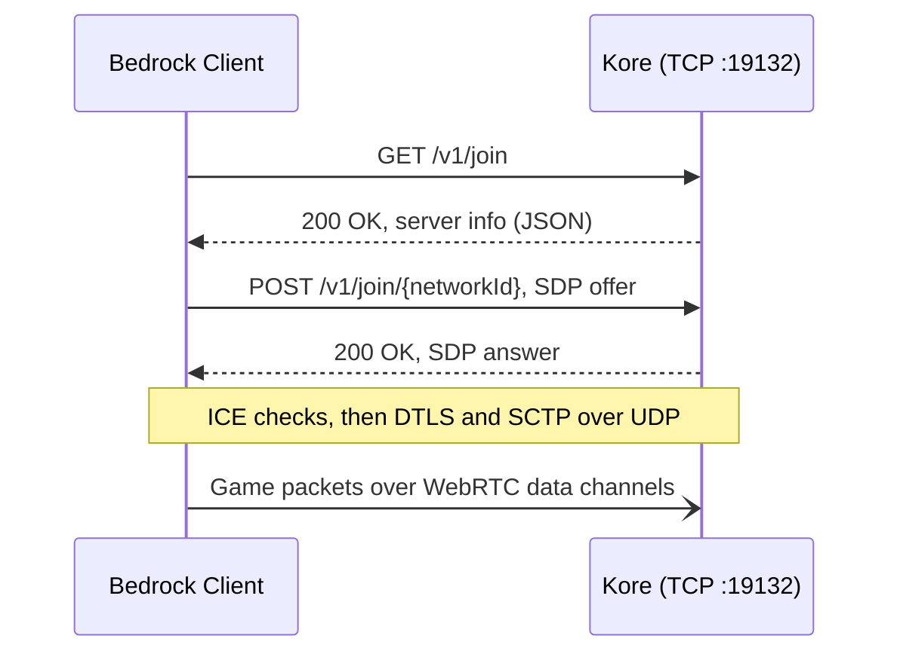

<div align="center">

# ⛏️ Kore

**A lean, modern Minecraft: Bedrock Edition server engine, written from scratch in Kotlin.**

[](https://kotlinlang.org)
[](https://adoptium.net)
[](https://netty.io)
[](https://minecraft.wiki/w/NetherNet)
[](#-milestones)
[](LICENSE)

[Philosophy](#-philosophy) · [Tech Stack](#-tech-stack) · [How It Connects](#-how-a-client-connects) · [Getting Started](#-getting-started) · [Milestones](#-milestones) · [Contributing](CONTRIBUTING.md)

</div>

---

> [!WARNING]
> Kore is in early development. Players can join a flat world, walk around it, build in it and open its doors, but they can't see each other yet.
> Follow the [milestones](#-milestones) to see where things stand.

## 🧭 Philosophy

Kore is not a fork, a wrapper, or a port of an existing server. It's a ground-up engine built around a few rules:

- **Simple beats clever.** Small files, flat packages, plain functions. If a newcomer can't follow a code path in one sitting, it's too complicated.
- **Fast by default.** Non-blocking I/O end to end, no reflection-driven plugin layer, no work on the event loop that doesn't belong there.
- **Real Kotlin.** Data classes, sealed types, extension functions and lambdas. Not Java written with Kotlin syntax.
- **No legacy baggage.** No `Manager` singletons, no abstract base class towers, no Bukkit-era patterns kept around for familiarity.
- **NetherNet only.** RakNet is deprecated for Bedrock Dedicated Server. Kore targets the WebRTC-based NetherNet transport and nothing else.

## 🧰 Tech Stack

| Layer | Choice | Why |
| --- | --- | --- |
| Language | **Kotlin 2.4** on **JDK 25** | Concise, null-safe, and a first-class JVM citizen. |
| Build | **Gradle** (Kotlin DSL) | One language for the code and the build. |
| Networking | **Netty 4** | Battle-tested non-blocking I/O for both the TCP signaling and the UDP game traffic. |
| Serialization | **kotlinx.serialization** | Compile-time JSON codecs with no reflection. |
| NBT | **Cloudburst NBT** | Reads the vanilla data, and writes NBT for packets and block state hashes. No dependencies of its own. |
| Game data | **[KoreMC/data](https://github.com/KoreMC/data)** | Items, block states, biomes and the creative inventory, dumped from the game by CloudburstMC. Kept in its own repository and read from `data/` on start. |
| Security | **JDK** (DTLS 1.2, ECDSA) | The JDK's non-blocking DTLS engine fits Netty, and needs no native libraries or BouncyCastle. |
| Logging | **SLF4J + Logback** | Structured, configurable, and fast enough to stay out of the way. |

## 🔌 How a Client Connects

NetherNet splits a connection into two phases: an HTTP signaling handshake over TCP, followed by a WebRTC peer connection that carries gameplay over UDP.



| Step | What happens | Kore status |
| --- | --- | --- |
| Discovery | `GET /v1/join` returns name, version, level and player counts as JSON | ✅ Implemented |
| Offer / answer | `POST /v1/join/{networkId}` exchanges SDP with all ICE candidates included. The answer is signed with the operator identity. | ✅ Implemented |
| Connectivity | ICE checks find a UDP path, then DTLS secures it | ✅ Implemented |
| Data channels | SCTP inside DTLS carries the `ReliableDataChannel` and `UnreliableDataChannel` | ✅ Implemented |
| Framing | A one-byte header splits large messages across the reliable channel and joins them back up | ✅ Implemented |

Kore keeps its side of WebRTC as small as possible. It runs **ICE-lite** and takes the **passive DTLS** role, so it never initiates anything. Every client shares one UDP port: Kore answers their connectivity checks, then waits for each client's first DTLS message. A client's DTLS certificate is accepted only if it matches the fingerprint in that client's offer.

**SCTP is written in Kotlin**, with no native libraries. It covers only what data channels need: one path, no multihoming, and partial reliability so the unreliable channel can drop messages instead of retransmitting them.

Game code sees none of this. Each client is a `NetherNetConnection` that sends and receives whole messages, reliably or not, through three callbacks:

| Callback | When it runs |
| --- | --- |
| `onConnect` | Once, as soon as the client's reliable channel opens and it can be sent to |
| `onMessage` | For every complete message |
| `onDisconnect` | Once, with a reason, for every client `onConnect` announced: it closed, timed out, broke the protocol, or the server stopped |

All three run on the UDP event loop, so they must never block. If one throws, the error is logged and the connection carries on.

## 🚀 Getting Started

**Requirements:** JDK 25. Gradle downloads a matching toolchain if you don't have one.

```bash
git clone https://github.com/KoreMC/kore.git
cd kore
git clone https://github.com/KoreMC/data.git data
./gradlew run
```

The second clone fetches the [game data](#-vanilla-data) Kore reads on start. Kore won't start without it.

Kore uses port `19132` for both signaling (TCP) and gameplay (UDP), so open both in your firewall. Check that signaling is reachable:

```bash
curl -i http://localhost:19132/v1/join
```

```json
{"name":"Kore Server","protocol":2193,"version":"1.26.50","level":"world","players":0,"maxPlayers":20,"gameType":0}
```

The console shows what's happening at `INFO`. Each run also writes everything, at `DEBUG`, to its own file in `logs/`, named for when the server started (for example, `logs/kore-2026-10-11_14-10-57.log`). The file has:
- requests and their headers, and SDP offers;
- each step of every connection;
- every packet batch in and out, listed by packet.

Once a player is in the game, batches holding nothing but movement are left out, since one arrives every tick. Movement carrying an action, like breaking a block, stays in. Set the `org.koremc.packets` logger to `TRACE` in [`logback.xml`](src/main/resources/logback.xml) to include them.

Player identity tokens are redacted, and logins are logged only by size. Kore never deletes old logs, so clear out `logs/` now and then.

### 🔑 The Operator Key

On first run, Kore creates `operator.key` in its working directory. Every SDP answer is signed with this key. Players connecting over plain HTTP are asked to trust it once, and then the client remembers it.

- **Keep it safe.** Anyone holding it can sign answers as your server.
- **Don't regenerate it.** A new key prompts every returning player again.
- **Share it across servers** if you run several. Players then trust them all with one prompt.

### 🛡️ Authentication

Kore runs in **online mode** by default: every player must prove who they are through Xbox Live. Each check closes off a different way of lying:

1. **The offer** carries the client's key and its signature over the connection's DTLS fingerprints. That ties the connection to a key the client holds.
2. **The login token** must be signed by Minecraft's authorization service, for the multiplayer audience, and must not have expired.
3. **The login's key** must be the one the offer proved. A login captured from one connection can't be replayed on another.
4. **The client data** (skin, device and so on) must be signed by that key.

Kore finds the authorization service through Minecraft's service discovery and keeps its signing keys cached, refreshing them in the background. So the server needs outbound HTTPS. A login that fails any check gets a `Disconnect`, and the reason goes to the log.

`onlineMode = false` turns all of this off for local testing. Anyone can then join under any name, so never run it where the public can reach it.

### 📦 Vanilla Data

Clients expect the server to agree with them about the game itself: which items and biomes exist, what the creative inventory holds, and what each block state is called on the network. [CloudburstMC/Data](https://github.com/CloudburstMC/Data) dumps that data from the game, and Kore keeps its copy in a repository of its own, [KoreMC/data](https://github.com/KoreMC/data), apart from the code. Kore reads it once on start from `data/` in its working directory (`dataDirectory` in `ServerConfig`). If a file is missing, Kore names it and stops.

- **Items** go to every player in the `ItemRegistry`, with the runtime ID each one travels by. The list is the same for everyone, so Kore encodes it once on start rather than at every login.
- **Biomes** follow in the `BiomeDefinitionList`: each one's climate, colours and tags. Kore leaves out the world generation data, which only a client generating its own terrain would use, so the packet stays under 8 KB.
- **The creative inventory** follows, as `CreativeContent`: 124 groups across the four tabs, and 1,980 items, including recent ones like the mushroom shelf and wool and concrete stairs and slabs. Each item names the block state it places and carries its NBT, like an enchanted book's enchantment. It's encoded once on start, too. Because Kore tells the client that the server owns inventories, the client can't even open its own inventory without asking: Kore answers with `ContainerOpen`, and agrees when the client closes it.

For the same reason, Kore keeps each player's inventory itself. Every move the player makes is an item stack request: the client predicts the result, and Kore either agrees, listing each changed slot and the ID of the stack now there, or rejects it, which makes the client undo it. Each request names the stacks it expects to find, and one that doesn't match what Kore has is rejected whole. The client doesn't wait for one answer before the next request, so a request can name a stack that an earlier one made by that request's number. Kore remembers recent requests to follow those. Picking from the creative inventory puts a full stack in a hidden output slot for the client to take from. Dropping items waits for item entities, and crafting for recipes.
- **Blocks defined in data**, rather than in the game's code, go in `StartGame`. Since 26.50 that includes the wool and concrete stairs and slabs and the shelf mushroom. Without their definitions, the client knows these blocks exist but not how they look, and shows them as placeholders.
- **Block states** are named on the network by a hash, not by their place in a palette: the 32-bit FNV-1a hash of the state's name and properties, written as little-endian NBT. Mojang's protocol docs don't spell the rule out, so the tests check it against the network ID the game gave each of the 22,091 states in its palette.

The data must be for the same client release as `version` in `ServerConfig`.

### 🌍 The World

Until worlds load from disk, every player joins the vanilla flat world: bedrock, two layers of dirt and grass on top, all plains. They appear at `0, -60, 0`, standing on the grass.

Once the client says how far it wants to see, Kore settles on a radius no larger than `viewDistance` (8 chunks by default). It then sends every chunk within that circle whole, nearest first, so the client never has to ask for sub-chunks one at a time. Only then does the player spawn. Until players change them, all the chunks are identical, so the flat world builds just one and sends it everywhere. It keeps a copy of each chunk a player changes, for as long as the server runs.

Movement is server-authoritative in Bedrock: every tick, the client sends its input and where it predicts its player now is. A server is meant to simulate the same movement and correct the client when they disagree. Mojang's movement guide also allows a server without physics to accept the client's position as given, and for now that's what Kore does. It only rejects positions that are impossible: not a number, or millions of blocks out. Once a player strays two chunks from the centre of their view, Kore centres it on them again and sends the chunks that have come into it. Players often step back and forth over a chunk border, and if the view followed every step, each one would resend the same row of chunks. This way, the view trails a moving player by up to a chunk or so instead.

The client also needs to be told about its own player once it spawns, or it moves the player wrongly: it floats instead of falling, and counts its air down as though underwater. So Kore sends the player's actor data (it breathes, falls, collides and climbs), its attributes (full health and hunger, since sprinting needs food, and walking speed), and the abilities its game mode allows.

The input the client sends each tick also says when the player starts and stops sprinting or sneaking. Kore keeps track, and sends the change back as the player's actor data, with a sneaking player's shorter height. It tags the update with the input's tick, so the client applies it at the moment it predicted it, as Mojang's movement guide describes. The sprint's speed boost is left to the client, which already applies it.

Building works the same way: the client predicts what happens, and Kore agrees or puts it right. Placing a block arrives as an inventory transaction that uses the held item on a block. The client says whether it found the placement works, having checked things Kore doesn't, like whether a torch has a face to stand on or a block would go inside the player. Kore only places what the client found works. It also checks that the item is the block it has in that hotbar slot, that the spot is in reach and that there's room. Then it puts the block in the world and shows it, with its sound, to everyone who has the chunk. It follows the client's rules for the common cases:
- blocks like short grass are replaced, rather than built beside;
- slabs go in the half of the space the player clicked, and two make a double slab;
- stairs climb the way the player faces;
- logs and other pillars lie along the clicked face's axis;
- furnaces, chests and other blocks with a front turn it to the player, while fence gates face the way the player does and trapdoors hinge on the side away from them;
- buttons, levers and ladders need a whole face to go on, like a full block's or the back of stairs, and point out of it. A lever on a floor or ceiling lies the way the player faces;
- a torch leans on the block it was placed against, if that face is whole. If not, it leans on a neighbour's whole face, or stands on the floor;
- anything fixed to a block falls when the block breaks;
- fences, panes, bars and walls join what's beside them: their own kind, gates set across them and whole faces, though not leaves, pumpkins, melons, barriers or shulker boxes. Walls stand tall under a block that covers them, and raise a post where they stand alone, end or turn. A fence gate drops when set in a wall;
- stairs turn a corner against stairs of the same half set across them, as in Java Edition: an outer corner at their back, or an inner one at their step, but not where it would break a straight run;
- placing or breaking a block reshapes the ones around it that join or turn, and so on to theirs;
- tall plants, like sunflowers, and doors take two blocks, and need a whole top to stand on. A door hinges on its right if there's a door to its left to pair with, or a wall to its right and not its left.

Cloudburst's data has no block shapes, so Kore tells which blocks are whole cubes by name: slabs, stairs, fences, plants and the like come in families named alike. A slab's face on the side it fills is whole, and so are the backs and bottoms of stairs. Kore doesn't know every block's rules, like which way a piston or an anvil turns, so after each placement it tells the client what's really at the spots it may have changed. That corrects any guess that differed. Door items carry no block state, so Kore places the door of the same name. Beds and signs are items too, and can't be placed yet.

Clicking a lever, button, door, trapdoor or fence gate uses it instead, unless the player sneaks with something in hand. A lever flips, a button presses in and pops back out a second or so later, and doors, trapdoors and fence gates open and shut: a door's two halves together, and a gate away from the player. Everyone with the chunk sees the change and hears it. Each sound names the block making it, so the client plays that block's own: a lever's click, or a bamboo button's. Iron doors and trapdoors only open with redstone, and Kore has no redstone yet, so nothing levers and buttons switch on is powered.

In creative, the client breaks a block at once and says so with a `PlayerAction`. Outside creative, it reports a finished break in its input. With server-authoritative block breaking off, Mojang leaves the timing of a break to the client, so Kore takes its word for it. Either way, everyone with the chunk sees the block go, with the particles and sound of it breaking: the client leaves those to the server, even for its own breaks. Outside creative, bedrock and other blocks only creative players break stay put. Survival mining doesn't show cracks yet, since their speed depends on each block's hardness, which Cloudburst's data doesn't have. Broken blocks drop nothing until there are item entities.

Chunks name biomes by number, and Cloudburst's data has none for vanilla biomes. For now, plains is hard-coded as biome `1`.

> [!NOTE]
> Server settings live in [`ServerConfig.kt`](src/main/kotlin/ServerConfig.kt) until there's a config file. The defaults target 1.26.50 (protocol `2193`). Update `protocol` and `version` together, along with the [vanilla data](#-vanilla-data), when moving to a new client release. Behind NAT, set `advertisedAddresses` to your public IP so clients get a candidate they can reach.

## 🗂️ Project Layout

```text
src/main/kotlin/
├── Main.kt                          # Entry point: wires config, server and shutdown
├── ServerConfig.kt                  # Server settings
├── Session.kt                       # Each player's walk through the login sequence
├── GameData.kt                      # What every session shares: the world and the game's definitions
├── Authentication.kt                # Deciding whether a login proves who it claims to be
├── auth/
│   ├── Jose.kt                      # Signed tokens and the keys that verify them
│   └── MultiplayerTokens.kt         # Minecraft's authorization service and its signing keys
├── protocol/
│   ├── Buffers.kt                   # Varints, strings and other wire primitives
│   ├── Batch.kt                     # Batching packets, with zlib compression
│   ├── Packets.kt                   # Packet types and their encodings
│   ├── StartGame.kt                 # The packet that sets up the world on the client
│   ├── LevelChunk.kt                # Chunk columns and paletted storage on the wire
│   ├── ActorData.kt                 # Actors' synced data and flags
│   ├── Attributes.kt                # Health, hunger, speed and other attributes
│   ├── Abilities.kt                 # What a player may do in their game mode
│   ├── ItemStackRequest.kt          # Inventory requests from the client, and the answers
│   ├── CreativeContent.kt           # The creative inventory, and items on the wire
│   ├── Blocks.kt                    # Using items on blocks, block updates, and the effects players see
│   └── LoginRequest.kt              # Reading who a client claims to be
├── world/
│   ├── Positions.kt                 # Block, chunk and exact positions
│   ├── Player.kt                    # A player's size, breath and speed
│   ├── PalettedStorage.kt           # A sub-chunk's worth of values, as a palette and indices
│   ├── Chunk.kt                     # Chunk columns, and which are in a player's view
│   ├── FlatWorld.kt                 # The same layers in every column, until players change them
│   ├── Building.kt                  # Where placed blocks go and which way they turn, and breaking them
│   ├── Using.kt                     # Levers, buttons, doors, trapdoors and fence gates, clicked
│   ├── Connections.kt               # Fences, panes and walls joining the blocks beside them
│   └── Shapes.kt                    # Which blocks are whole cubes, and which faces can hold a torch or a button
├── inventory/
│   ├── PlayerInventory.kt           # A player's slots: hotbar, inventory, offhand, armour and cursor
│   └── StackRequests.kt             # Carrying out item stack requests, all or nothing
├── registry/
│   ├── VanillaData.kt               # Loads the game's items, block states and biomes on start
│   ├── Items.kt                     # Items, as the client's item registry lists them
│   ├── Biomes.kt                    # Biomes, as the client's biome definitions describe them
│   ├── Creative.kt                  # The creative inventory's tabs, groups and items
│   └── BlockStates.kt               # Block states and the hashes the client knows them by
└── network/
    ├── SignalingServer.kt           # TCP bootstrap and HTTP pipeline
    ├── NetherNetSignalingHandler.kt # Routes /v1/join requests
    ├── JoinInfo.kt                  # Discovery response body
    ├── RtcServer.kt                 # UDP bootstrap
    ├── NetherNetRtcHandler.kt       # Routes UDP traffic through STUN, DTLS and SCTP per client
    ├── NetherNetConnection.kt       # One client's channels, with NetherNet's message framing
    ├── rtc/
    │   ├── Sdp.kt                   # Offer parsing and answer encoding
    │   ├── LocalPeer.kt             # Builds answers from this server's WebRTC state
    │   ├── Peer.kt                  # Clients between signaling and disconnect
    │   ├── ClientIdentity.kt        # Checking the identity in a client's offer
    │   ├── Ice.kt                   # ICE credentials and host candidates
    │   ├── Stun.kt                  # STUN messages for ICE-lite
    │   ├── Dtls.kt                  # DTLS engines and per-client transport
    │   ├── DtlsCertificate.kt       # Self-signed DTLS certificate and fingerprint
    │   └── OperatorIdentity.kt      # Operator key and a=identity assertions
    └── sctp/
        ├── Chunks.kt                # SCTP packet and chunk encoding
        ├── SctpAssociation.kt       # Handshake, reassembly, retransmission and congestion control
        └── DataChannels.kt          # Opening data channels (DCEP)
```

Packages follow the Kotlin convention of omitting the common root, so `org.koremc.network` lives in `src/main/kotlin/network/`.

## 🗺️ Milestones

### Phase 1: Transport
- [x] Netty bootstrap with an HTTP/1.1 pipeline
- [x] **NetherNet HTTP Signaling:** discovery (`GET /v1/join`)
- [x] **NetherNet HTTP Signaling:** SDP offer/answer (`POST /v1/join/{networkId}`)
- [x] **UDP Channel Negotiation:** ICE-lite connectivity checks
- [x] **UDP Channel Negotiation:** DTLS 1.2 handshake with fingerprint verification
- [x] **UDP Channel Negotiation:** SCTP association and data channels
- [x] Message framing over reliable and unreliable data channels

### Phase 2: Protocol
- [x] Batches, zlib compression and the packet codec
- [x] Network settings negotiation and protocol version checks
- [x] Reading the login's connection request and client data
- [x] Verify login tokens, and bind them to the identity in the client's offer
- [x] Login success and resource pack negotiation (no server packs yet)
- [x] `StartGame` and chunk radius negotiation
- [x] **Cloudburst NBT Parsing**
- [x] Vanilla item registry and block state hashes, from CloudburstMC's data
- [x] Biome definitions
- [x] Chunks and spawning, in a flat world
- [ ] Packet registry for the rest of the protocol

### Phase 3: World
- [ ] **World Loading** (LevelDB)
- [ ] Chunk serialization
- [x] Chunk streaming as players move
- [x] Player spawning and movement, taking the client's word for its position
- [ ] Movement simulation and corrections

### Phase 4: Gameplay
- [x] Creative inventory, from CloudburstMC's data
- [x] Block placing and breaking, taking the client's word for break times
- [ ] Survival mining: cracks as blocks break, and what they drop
- [x] Using levers, buttons, doors, trapdoors and fence gates
- [ ] Redstone
- [x] Moving items around the player's inventory, and taking them from the creative inventory
- [ ] Other inventories: chests, crafting and so on
- [ ] Entities
- [ ] Commands

## 🤝 Contributing

Contributions are welcome. Read [CONTRIBUTING.md](CONTRIBUTING.md) before opening a pull request. It covers the code standards and the review process.

## 📚 References

- [NetherNet HTTP Signaling: Partner Onboarding Guide](https://mojang.github.io/bedrock-protocol-docs/guides/nether-net-onboarding-guide/) from Mojang
- [NetherNet](https://minecraft.wiki/w/NetherNet) and [Bedrock Edition protocol](https://minecraft.wiki/w/Bedrock_Edition_protocol) on the Minecraft Wiki
- [CloudburstMC](https://github.com/CloudburstMC) for the [NBT library](https://github.com/CloudburstMC/NBT) and the [game data](https://github.com/CloudburstMC/Data) Kore reads

## 📄 License

Kore is released under the [MIT License](LICENSE).

<sub>Kore is not an official Minecraft product and is not approved by or associated with Mojang Studios or Microsoft.</sub>
