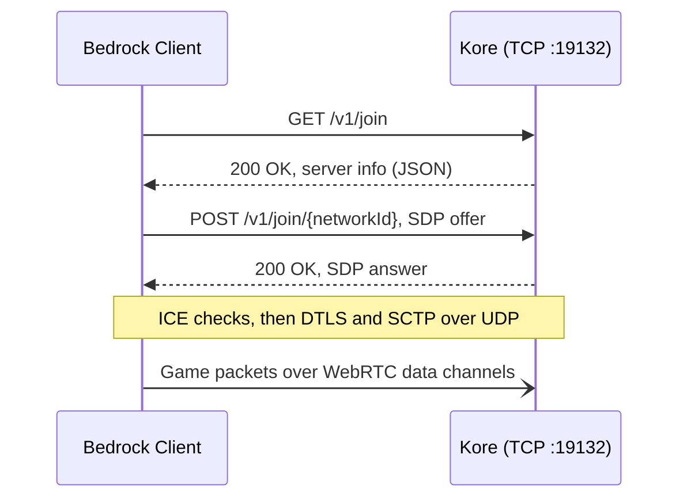

<div align="center">

# ⛏️ Kore

**A lean, modern Minecraft: Bedrock Edition server engine, written from scratch in Kotlin.**

[](https://kotlinlang.org)
[](https://adoptium.net)
[](https://netty.io)
[](https://minecraft.wiki/w/NetherNet)
[](#-milestones)
[](LICENSE)
[](https://discord.gg/hNG9t24NNK)

[Philosophy](#-philosophy) · [Getting Started](#-getting-started) · [What Works](#-what-works) · [Milestones](#-milestones) · [Contributing](CONTRIBUTING.md)

</div>

---

> [!WARNING]
> Kore is in early development. Players can join a flat world, build, mine, craft, wire up redstone and pistons, and play together, but there are no mobs, and nothing is saved yet.
> Follow the [milestones](#-milestones) to see where things stand.

## 🧭 Philosophy

Kore is not a fork, a wrapper, or a port of an existing server. It's a ground-up engine built around a few rules:

- **Simple beats clever.** Small files, flat packages, plain functions. If a newcomer can't follow a code path in one sitting, it's too complicated.
- **Fast by default.** Non-blocking I/O end to end, no reflection-driven plugin layer, no work on the event loop that doesn't belong there.
- **Real Kotlin.** Data classes, sealed types, extension functions and lambdas. Not Java written with Kotlin syntax.
- **No legacy baggage.** No `Manager` singletons, no abstract base class towers, no Bukkit-era patterns kept around for familiarity.
- **NetherNet only.** RakNet is deprecated for Bedrock Dedicated Server. Kore targets the WebRTC-based NetherNet transport and nothing else.
- **Vanilla behaviour.** Kore plays like Bedrock Edition. Server policy, like rate limits, is for whoever builds on it.

## 🧰 Tech Stack

| Layer | Choice |
| --- | --- |
| Language | **Kotlin 2.4** on **JDK 25** |
| Build | **Gradle** (Kotlin DSL) |
| Networking | **Netty 4**, for TCP signaling and UDP gameplay |
| WebRTC | ICE-lite, DTLS 1.2 from the **JDK**, and **SCTP written in Kotlin**, with no native libraries |
| NBT | **Cloudburst NBT** |
| Game data | **[KoreMC/data](https://github.com/KoreMC/data)**, dumped from the game by CloudburstMC, with mining and stack data from minecraft-data |
| Logging | **SLF4J + Logback** |

## 🔌 How a Client Connects

NetherNet splits a connection into two phases: an HTTP signaling handshake over TCP, then a WebRTC peer connection that carries gameplay over UDP.



Kore runs ICE-lite and takes the passive DTLS role, so it never initiates anything, and every client shares one UDP port. Game code sees each client as a `NetherNetConnection` that sends and receives whole messages.

## 🚀 Getting Started

**Requirements:** JDK 25. Gradle downloads a matching toolchain if you don't have one.

```bash
git clone https://github.com/KoreMC/kore.git
cd kore
git clone https://github.com/KoreMC/data.git data
./gradlew run
```

The second clone fetches the game data Kore reads on start, from `data/`. Kore won't start without it, and it must be for the same client release as Kore (1.26.50, protocol `2193`).

Kore uses port `19132` for both signaling (TCP) and gameplay (UDP), so open both in your firewall. Check that signaling is reachable:

```bash
curl -i http://localhost:19132/v1/join
```

The console logs at `INFO`. Each run also writes everything at `DEBUG` to its own file in `logs/`. Kore never deletes old logs, so clear them out now and then.

### ⚙️ Configuration

Settings live in [`ServerConfig.kt`](src/main/kotlin/ServerConfig.kt) until there's a config file. Behind NAT, set `advertisedAddresses` to your public IP so clients get a candidate they can reach. When moving to a new client release, update `protocol`, `version` and the data together.

### 🔑 The Operator Key

On first run, Kore creates `operator.key`, which signs every SDP answer. Players are asked to trust it once, and the client remembers it.

- **Keep it safe.** Anyone holding it can sign answers as your server.
- **Don't regenerate it.** A new key prompts every returning player again.
- **Share it across servers** if you run several, so players trust them all at once.

### 🛡️ Authentication

Kore runs in **online mode** by default: every player proves who they are through Xbox Live, and their login is tied to the key in their connection's offer. The server needs outbound HTTPS to fetch Minecraft's signing keys. `onlineMode = false` turns this off for local testing; never run it where the public can reach it.

### ⌨️ Commands and Operators

Players run commands from the chat, and the console runs them without the slash. No one is an operator to start with, so once you've joined, type this in the console:

```text
op Steve
```

Operators are kept in `permissions.json`, as the dedicated server does. Everyone may run `/list`, `/me` and `/tell`. Operators also get `/say`, `/kick`, `/op` and `/deop`, and with cheats on, `/gamemode`, `/give`, `/clear`, `/teleport`, `/xp` and `/enchant`. The console can also `/stop` the server. Target selectors like `@a[r=10]` and relative coordinates work as in the game.

## ✨ What Works

- **World:** the vanilla flat world, streamed to players as they move. Changes last as long as the server runs.
- **Building and mining:** placing blocks with the game's rules for slabs, stairs, doors, rails, fences, walls, scaffolding and the like; survival mining at the right pace, tool wear, and drops.
- **Items and inventory:** dropped items, picking up and merging, the creative inventory, and server-authoritative inventories.
- **Containers and workstations:** chests, barrels, shulker boxes and ender chests; crafting; furnaces and brewing stands; stonecutters, smithing tables, anvils, grindstones, looms, enchanting tables and cartography tables; hoppers, dispensers, droppers and crafters; lecterns, and writing and signing books; beacons and their powers; experience.
- **Maps:** drawn as players explore, locator maps, and zooming out, copying and locking them.
- **Redstone:** levers, buttons, pressure plates, redstone blocks, torches, dust, repeaters, comparators and observers, powering doors, trapdoors, fence gates, lamps, hoppers, dispensers and droppers.
- **Pistons:** pushing and pulling blocks, slime and honey, flying machines, chests and furnaces with their contents, and the players, items and orbs in the way or on top.
- **Players:** seeing each other, skins, chat, and joining and leaving messages in each player's language.

## 🗂️ Project Layout

Packages leave out the common root, so `org.koremc.network` lives in `src/main/kotlin/network/`.

| Package | What's in it |
| --- | --- |
| [`network`](src/main/kotlin/network) | Signaling, and the WebRTC stack: ICE, DTLS and SCTP |
| [`protocol`](src/main/kotlin/protocol) | Packets and how they're written on the wire |
| [`auth`](src/main/kotlin/auth) | Login tokens and Minecraft's signing keys |
| [`registry`](src/main/kotlin/registry) | The game's items, block states, biomes, recipes and enchantments |
| [`world`](src/main/kotlin/world) | Blocks, items, redstone, pistons and everything else that happens in the world |
| [`inventory`](src/main/kotlin/inventory) | Players' inventories, item stack requests, crafting and workstations |
| [`command`](src/main/kotlin/command) | Commands, selectors, operators and the console |

[`Session.kt`](src/main/kotlin/Session.kt) takes each player from login into the game, and [`Main.kt`](src/main/kotlin/Main.kt) wires it all together.

## 🗺️ Milestones

### Phase 1: Transport
- [x] NetherNet signaling: discovery and SDP offer/answer
- [x] ICE-lite, DTLS 1.2 and SCTP data channels
- [x] Message framing over reliable and unreliable channels

### Phase 2: Protocol
- [x] Batches, compression and the packet codec
- [x] Login, with online-mode authentication
- [x] `StartGame`, the item registry, block states and biomes
- [ ] Packet registry for the rest of the protocol

### Phase 3: World
- [x] Chunk streaming in a flat world
- [x] Player spawning and movement, taking the client's word for its position
- [ ] **World loading and saving** (LevelDB)
- [ ] Movement simulation and corrections

### Phase 4: Gameplay
- [x] Building, survival mining and tool wear
- [x] Items, inventories and the creative inventory
- [x] Containers, crafting, furnaces, brewing and workstations
- [x] Hoppers, dispensers, droppers and crafters
- [x] Lecterns, and writing and signing books
- [x] Redstone, pistons, pressure plates and lamps
- [x] Players seeing each other, chat and commands
- [x] Beacons, maps and cartography tables
- [ ] Mobs
- [ ] The rest of the game's commands

## 🤝 Contributing

Contributions are welcome. Read [CONTRIBUTING.md](CONTRIBUTING.md) before opening a pull request. It covers the code standards and the review process.

## 📚 References

- [NetherNet HTTP Signaling: Partner Onboarding Guide](https://mojang.github.io/bedrock-protocol-docs/guides/nether-net-onboarding-guide/) from Mojang
- [NetherNet](https://minecraft.wiki/w/NetherNet) and [Bedrock Edition protocol](https://minecraft.wiki/w/Bedrock_Edition_protocol) on the Minecraft Wiki
- [CloudburstMC](https://github.com/CloudburstMC) for the [NBT library](https://github.com/CloudburstMC/NBT) and the [game data](https://github.com/CloudburstMC/Data) Kore reads
- [gophertunnel](https://github.com/Sandertv/gophertunnel) and [Dragonfly](https://github.com/df-mc/dragonfly), which Kore checks its encodings against

## 📄 License

Kore is released under the [MIT License](LICENSE).

<sub>Kore is not an official Minecraft product and is not approved by or associated with Mojang Studios or Microsoft.</sub>
